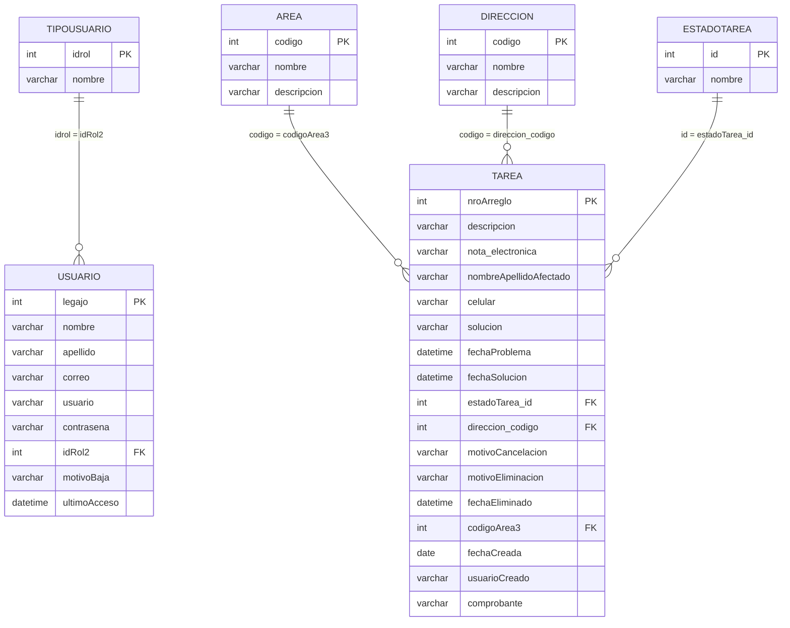

# Modelo de dominio

> Fase 0 — entidades, atributos y relaciones reconstruidos desde `mantenimiento.sql` y el uso real en el código PHP.
> Cuando una columna existe en la base pero no se usa, o se usa de forma distinta a su nombre, se indica explícitamente.

## 1. Diagrama de relaciones

## 2. Entidades

### 2.1 Tarea / Requerimiento (`tareas`)

Entidad central. Representa un requerimiento de mantenimiento.

| Atributo | Tipo | Nulo | Semántica observada | Evidencia |
|---|---|---|---|---|
| `nroArreglo` | `int(11)` PK, autoincrement | No | Identificador visible al usuario ("Tarea N° X"). | `mantenimiento.sql:59`; todas las vistas |
| `descripcion` | `varchar(1000)` | Sí | Texto libre del problema. Obligatorio en el formulario. | `listarTareasAdmin.php:179` |
| `nota_electronica` | `varchar(45)` | Sí | Nota electrónica asociada al requerimiento. **Opcional**. El largo (45) resulta insuficiente para una nota real. | `mantenimiento.sql:61`; creación y edición |
| `nombreApellidoAfectado` | `varchar(100)` | Sí | Persona afectada por el problema. Opcional. | `listarTareasAdmin.php:196` |
| `celular` | `varchar(20)` | Sí | Contacto del afectado. Opcional. | `listarTareasAdmin.php:201` |
| `solucion` | `varchar(500)` | Sí | "Materiales utilizados" / solución aplicada. Se completa al terminar. | `m_consultas.php:439`; `listarTareasAdmin.php:870` |
| `fechaProblema` | `datetime` | Sí | Marca temporal de creación del requerimiento (`NOW()`), aunque el nombre sugiere la fecha del problema. | `m_consultas.php:401` |
| `fechaSolucion` | `datetime` | Sí | Marca de finalización (`NOW()`). | `m_consultas.php:439` |
| `estadoTarea_id` | `int(11)` | Sí | FK a `estadotarea`. 1..5. | `mantenimiento.sql:82` |
| `direccion_codigo` | `int(11)` | Sí | FK a `direcciones`. | `mantenimiento.sql:81` |
| `motivoCancelacion` | `varchar(500)` | Sí | Motivo obligatorio al cancelar. | `m_consultas.php:452` |
| `motivoEliminacion` | `varchar(500)` | Sí | Motivo obligatorio al eliminar lógicamente. | `m_consultas.php:464` |
| `fechaEliminado` | `datetime` | Sí | `NOW()` al eliminar. | `m_consultas.php:464` |
| `codigoArea3` | `int(11)` | Sí | FK a `areas`. El sufijo `3` no tiene significado funcional documentado. | `mantenimiento.sql:80` |
| `fechaCreada` | `date` | Sí | `CURDATE()` al crear. Base de la mayoría de las estadísticas. | `m_consultas.php:401` |
| `usuarioCreado` | `varchar(100)` | Sí | **Nombre y apellido concatenados**, no el legajo ni el id. Se usa como clave de unión con `usuario`. | `m_consultas.php:323` |
| `comprobante` | `varchar(255)` | Sí | Ruta relativa del PDF subido (ej. `../comprobantes/archivo.pdf`). | `c_terminarTarea.php:9-13` |

**Ausencias relevantes** (no existen columnas ni tablas):

- Responsable/asignado de la tarea.
- Prioridad, severidad, categoría, tipo.
- Fecha de inicio (sólo hay fecha de problema y de solución).
- Autor de la cancelación, finalización o edición.
- Historial de estados o de cambios.
- Relación con un usuario por clave foránea.
- Adjuntos múltiples.
- Comentarios/observaciones.

### 2.2 Estado de tarea (`estadotarea`)

Catálogo cerrado, sin ABM en la aplicación.

| `id` | `nombre` | Uso en código |
|---|---|---|
| 1 | `Pendiente` | Estado inicial; listado "actual"; contadores. |
| 2 | `En Progreso` | Tras "Iniciar la tarea"; listado "actual". |
| 3 | `Completo` | Tras "Terminar tarea"; listado de completadas. |
| 4 | `Cancelado` | Tras "Cancelar tarea"; listado de canceladas. |
| 5 | `Eliminado` | Borrado lógico; listado de eliminadas. |

Evidencia de los valores: `mantenimiento.sql:50-55`. Los nombres se usan como literales en `m_estadisticas.php` y en comparaciones de la vista (`$listTarea[7] == 'Pendiente'`), lo que hace que **renombrar un estado rompa la aplicación**.

### 2.3 Área (`areas`)

| Atributo | Tipo | Nulo | Semántica |
|---|---|---|---|
| `codigo` | `int(11)` PK, autoincrement | No | Identificador interno. |
| `nombre` | `varchar(100)` | Sí | Nombre del área; obligatorio en el formulario. |
| `descripcion` | `varchar(255)` | Sí | Descripción; obligatoria en el formulario. |

- Se administra por alta y edición (no hay baja).
- Se muestra en los listados de tareas como "Área encargada" / "Área donde se lleva a cabo".
- Se usa como dimensión de estadísticas.

### 2.4 Dirección / Entidad (`direcciones`)

| Atributo | Tipo | Nulo | Semántica |
|---|---|---|---|
| `codigo` | `int(11)` PK, **sin autoincrement** | No | Código ingresado manualmente por el administrador. |
| `nombre` | `varchar(150)` | Sí | Nombre de la dirección o entidad; obligatorio. |
| `descripcion` | `varchar(500)` | Sí | Descripción; opcional. |

- Es un catálogo independiente de `areas`; una tarea referencia ambos.
- El código es la clave primaria y puede editarse (con riesgo de violar la FK si hay tareas asociadas).

### 2.5 Usuario (`usuario`)

| Atributo | Tipo | Nulo | Semántica |
|---|---|---|---|
| `legajo` | `int(11)` PK | No | Identificador del empleado. Se ingresa manualmente (rango sugerido 1000–19999 en el HTML). |
| `nombre` | `varchar(45)` | Sí | Nombre. |
| `apellido` | `varchar(45)` | Sí | Apellido. |
| `correo` | `varchar(45)` | Sí | Correo; opcional al crear. Sirve también como identificador de login. |
| `usuario` | `varchar(45)` | Sí | Nombre de usuario; identificador de login. Sin constraint de unicidad. |
| `contraseña` | `varchar(200)` | Sí | Hash `PASSWORD_DEFAULT` (bcrypt). El nombre de columna está en español y contiene `ñ`. |
| `idRol2` | `int(11)` | Sí | FK a `tipousuario.idrol`. `NULL` = usuario dado de baja. |
| `motivoBaja` | `varchar(500)` | Sí | Motivo de la baja lógica. |
| `ultimoAcceso` | `datetime` | Sí | Actualizado en cada login exitoso. |

**Notas**
- `nombre + apellido` se usa como identificador funcional en `tareas.usuarioCreado` (vía `CONCAT`), lo que genera dependencias frágiles (ver §4).
- No hay campo `activo`; la baja se representa por `idRol2 IS NULL`.
- No hay campo de fecha de alta, de baja ni de cambio de contraseña.

### 2.6 Tipo de usuario / Rol (`tipousuario`)

| Atributo | Tipo | Semántica |
|---|---|---|
| `idrol` | `int(11)` PK | 3 = Administrador, 4 = Administrativo. |
| `nombre` | `varchar(45)` | Etiqueta mostrada en la UI. |

- Catálogo sin ABM. No hay permisos por rol en base: el código compara `== 3` para habilitar funciones.
- El identificador `idRol2` (con sufijo 2) y `idrol` sin sufijo sugieren un cambio de esquema previo.

### 2.7 Comprobante (no persistido como entidad)

- Es un archivo PDF almacenado en el directorio `comprobantes/` (fuera de `vistaAgente`, referenciado como `../comprobantes/` desde las vistas).
- Sólo se guarda su ruta en `tareas.comprobante`.
- No hay tabla de metadatos: nombre original, tamaño, tipo, fecha de subida ni usuario que subió.
- Un comprobante por tarea como máximo.
- No hay endpoint de descarga controlado: se enlaza directamente a la ruta del archivo.

### 2.8 Sesión (transitoria)

No se persiste en base. Claves usadas:

| Clave | Contenido |
|---|---|
| `username` | Texto ingresado en el login (usuario **o** correo). |
| `rol` | 3 o 4 (o `NULL` si el usuario está de baja). |
| `legajo` | Legajo del usuario autenticado. |
| `nombreApellido` | `"Nombre Apellido"` del usuario. |
| `time` | Timestamp del último acceso/actividad, para expiración a 60 min. |
| `errLogin`, `session_caducada` | Mensajes de la pantalla de login. |
| `areaOk`, `editadoOk`, `direccionOk`, `direccionEditada`, `direccionEditadaError`, `eliminadoOk`, `usuarioAgregado`, `usuarioError`, `bajaOk`, `altaOk`, `passBlanqueada`, `datosAct`, `datosActError`, `tareaOK`, `tareaAsignada`, `tareaTerminada`, `tareaCancelada`, `tareaEditada`, `tareaEliminada` | Banderas de "operación exitosa/fallida" consumidas una vez por las vistas para mostrar alertas. |

## 3. Relaciones y cardinalidades

| Relación | Cardinalidad | Implementación | Observaciones |
|---|---|---|---|
| Rol → Usuarios | 1:N | `usuario.idRol2 → tipousuario.idrol` | `NULL` permitido (baja). |
| Área → Tareas | 1:N | `tareas.codigoArea3 → areas.codigo` | `ON DELETE/UPDATE` no definido (RESTRICT por defecto). |
| Dirección → Tareas | 1:N | `tareas.direccion_codigo → direcciones.codigo` | Ídem. |
| Estado → Tareas | 1:N | `tareas.estadoTarea_id → estadotarea.id` | Ídem. |
| Usuario → Tareas creadas | 1:N *lógica* | `tareas.usuarioCreado = CONCAT(usuario.nombre, ' ', usuario.apellido)` | **No es FK**. Depende del texto; se rompe al renombrar o dar de baja al usuario. |
| Tarea → Comprobante | 1:0..1 | `tareas.comprobante` (ruta) | Sin integridad referencial. |

## 4. Reglas de integridad: lo que la base garantiza y lo que no

### Garantizado por el esquema
- PK de `tareas`, `areas`, `usuario`, `direcciones`, `estadotarea`, `tipousuario`.
- FK de `tareas` a `estadotarea`, `direcciones`, `areas`.
- FK de `usuario` a `tipousuario`.
- `codigo` de `direcciones` es único por ser PK.

### **No** garantizado (debe resolverse en la nueva implementación)
- Unicidad de `usuario.usuario`.
- Unicidad de `usuario.correo`.
- Formato/validez de correo.
- Existencia de un rol válido más allá de la FK (sí garantizada, pero se permite `NULL`).
- Que `tareas.estadoTarea_id` esté en el rango 1..5 (la FK lo garantiza si el catálogo no se altera).
- Que `tareas.usuarioCreado` corresponda a un usuario real.
- Que una tarea completada tenga `solucion` y `comprobante` no nulos (la regla es sólo de formulario).
- Que una tarea cancelada tenga `motivoCancelacion`.
- Que una tarea eliminada tenga `motivoEliminacion` y `fechaEliminado`.
- Que `fechaSolucion >= fechaProblema`.
- Que no existan áreas o direcciones duplicadas por nombre.

## 5. Correspondencia con la base

- Nombre de la base: `mantenimiento` (hardcodeada en `m_conexion.php` y `m_conexionPage.php`).
- Motor: InnoDB, `utf8` / `utf8_general_ci` (con la base creada en `utf8mb4`). Hay mezcla de collations (`areas` usa `utf8_unicode_ci`, el resto `utf8_general_ci`).
- `tareas` tiene `AUTO_INCREMENT=5` en el dump, aunque el dump no inserta filas: sugiere datos previos en el entorno de origen.
- No hay tabla de auditoría, ni de historial, ni de configuración, ni de parámetros.

## 6. Ambigüedades del modelo

1. **`fechaProblema` vs `fechaCreada`**: la primera se llena con `NOW()` al crear (no con la fecha real del problema) y la segunda con `CURDATE()`. Las estadísticas usan una u otra según la función (ver Q-010).
2. **`usuarioCreado` como texto**: no permite distinguir dos usuarios homónimos ni sobrevive a un cambio de nombre.
3. **`nota_electronica varchar(45)`**: el formulario la presenta como texto libre; el tamaño es llamativamente corto.
4. **`codigoArea3`**: el sufijo numérico no tiene explicación en el código ni en el esquema.
5. **`idRol2`**: sugiere que existió un `idRol` previo; no hay evidencia de su semántica.
6. **`solucion` rotulada "Materiales utilizados"**: el campo se usa para la solución/materiales, pero el nombre y la etiqueta no coinciden plenamente.
7. **`direcciones` sin autoincrement**: el código es ingresado a mano; no hay regla de formato documentada.
8. **Estado "Eliminado" dentro del catálogo de estados**: mezcla el ciclo de vida funcional con el borrado lógico.
