# Flujos funcionales

> Fase 0 — reconstrucción de los flujos a partir del código. Cada flujo indica el punto de entrada, los pasos reales (incluidas las consultas SQL) y las desviaciones detectadas.

## Convenciones

- **Entrada** = URL/pantalla que inicia el flujo.
- **Controlador** = archivo en `controlador/` que procesa la acción.
- **Modelo** = método de `modelo/m_consultas.php` o `modelo/m_estadisticas.php`.
- Las desviaciones se marcan con ⚠️ y se remiten a `open-questions.md`.

---

## F-01. Inicio de sesión

**Entrada:** `vistaAgente/login.php` (formulario `user`, `password`) → `POST controlador/c_login.php`.

1. `c_login.php` inicia sesión PHP y lee `$_POST['user']` y `$_POST['password']`.
2. `Consultas::autenticarUsuario($user, $pass)` ejecuta:
   `SELECT * FROM usuario WHERE usuario = '$user' OR correo = '$user'`.
3. Toma la primera fila y valida `password_verify($pass, $registro[5])` (columna `contraseña`).
4. Si es válido:
   - guarda en sesión `username`, `rol`, `legajo`, `nombreApellido`, `time`;
   - `verificarUltimoAcceso($user)` → `UPDATE usuario SET ultimoAcceso = now() WHERE usuario = '$user'`;
   - redirige a `vistaAgente/inicio.php`.
5. Si no es válido: guarda `$_SESSION['errLogin']` y vuelve a `login.php`, que muestra "Datos Erróneos. Ingrese nuevamente".

**Particularidades**
- El identificador puede ser **usuario o correo**; el sistema no distingue.
- Si el usuario se autenticó con correo, `$_SESSION['username']` contiene el correo. Varias operaciones posteriores asumen que es el nombre de usuario (ver F-09 y Q-006).
- No hay bloqueo por intentos fallidos, captcha, ni rate limiting.
- SQL construido por concatenación (inyección posible; ver `legacy-architecture.md`).

---

## F-02. Expiración de sesión y logout

**Expiración (por inactividad de 60 minutos)**

1. Cada vista incluida evalúa `if (!(time() - $_SESSION['time'] >= 3600))`.
2. Si la condición es verdadera (menos de 60 min), renueva `$_SESSION['time'] = time()` y renderiza.
3. Si es falsa, incluye `vistaAgente/destroySession.php`, que hace `session_destroy()` y muestra "Sesión caducada… Click aquí".

**Logout**

- `headerNav.php:113` enlaza a `vistaAgente/logout.php`, que hace `session_start(); session_destroy();` y redirige a `login.php`.

**Particularidades**
- El control se repite en cada vista (no hay middleware). `headerNav.php` sólo se renderiza si `isset($_SESSION['rol'])`.
- `<meta http-equiv="refresh" content="3600">` recarga la página cada hora.
- Un acceso sin sesión a `index.php` produce `time() - null >= 3600` → verdadero → sesión destruida y mensaje de caducidad (comportamiento correcto por accidente; genera *notice* de variable no definida).
- `destroySession.php` no está protegido: puede invocarse directamente.

---

## F-03. Panel de control (dashboard)

**Entrada:** `vistaAgente/inicio.php` (post-login).

1. Verifica inactividad (F-02) e incluye `headerNav.php`.
2. Instancia `Consultas` y `ConsultasEstadisticas`.
3. Obtiene:
   - `contarTareasTotal()` → total de filas de `tareas` (incluye eliminadas);
   - `contarTareasEstado("Pendiente" | "En Progreso" | "Completo" | "Cancelado" | "Eliminado")`;
   - `contarTotalUsuarios()`, `contarUsuariosRol(3)`, `contarUsuariosRol(4)`;
   - `contarDirecciones()`.
4. Renderiza tarjetas. Cada tarjeta de estado enlaza al listado correspondiente; la tarjeta "Total de eliminadas" enlaza a `listarTareasEliminadas`.
5. Sólo si `$_SESSION['rol'] == 3` muestra la sección "Usuarios".

**Particularidades**
- Los conteos del panel son **globales** (no dependen del período ni del usuario).
- `contarTotalUsuarios` cuenta todos los `legajo != 0`, incluyendo usuarios de baja (su `idRol2` es `NULL`). Los contadores por rol sí excluyen a los de baja.
- El total de tareas incluye las eliminadas, por lo que "Total de tareas" ≠ suma de las tarjetas de estado si se omitiera Eliminadas (aquí sí se muestra aparte).

---

## F-04. Ciclo de vida de una tarea

### F-04.1 Crear tarea

**Entrada:** `index.php?accion=listarTareasAdmin&lista=actual|completas|canceladas` → botón "Nueva Tarea" → `POST controlador/c_agregarTarea.php`.

Campos del formulario (`listarTareasAdmin.php:146-230`):

| Campo | Nombre POST | Obligatorio |
|---|---|---|
| Área involucrada | `selectArea` | Sí |
| Descripción | `descripcion` | Sí |
| Con Nota Electrónica (checkbox) | — | No |
| Nota Electrónica | `ne` | Sí si el checkbox está activo |
| Nombre y apellido del afectado | `nombreApellidoAfectado` | No |
| Nro de celular | `cel` | No |
| Dirección o entidad | `direccion` | Sí |
| Rol (hidden) | `rol` | Enviado, no usado |
| Nombre y apellido del creador (hidden) | `nombreApellido` | Enviado desde `$_SESSION['nombreApellido']` |

Procesamiento:

1. Lee los campos; si no existe `$_POST['nota_electronica']` asigna `NULL`.
2. `Consultas::agregarTarea(...)` ejecuta:
   ```sql
   INSERT INTO tareas(descripcion, nota_electronica, nombreApellidoAfectado, celular,
                      estadoTarea_id, fechaProblema, direccion_codigo, codigoArea3,
                      fechaCreada, usuarioCreado)
   VALUES (..., '1', NOW(), ..., curdate(), '<usuarioCreado>')
   ```
3. Marca `$_SESSION['tareaOK']` y redirige a `index.php?accion=listarTareasAdmin&lista=actual`, donde se muestra el alert "La tarea ha sido agregada".

**Desviaciones**
- ⚠️ El formulario envía la nota como `ne`, pero el controlador lee `$_POST['nota_electronica']`. **La nota electrónica nunca se guarda al crear** (siempre `NULL`). Ver Q-007.
- ⚠️ El campo `MAX_FILE_SIZE`/comprobante no participa en el alta.
- ⚠️ No se valida que el área/dirección existan (sólo la FK de la base).
- ⚠️ No hay control de rol ni de sesión en el controlador.

### F-04.2 Ver detalle

**Entrada:** menú "Acción → Ver más info" en cualquier listado de tareas.

- Se abre un modal con: descripción, nota electrónica (o "No proporcionado"), afectado, celular, materiales, comprobante (sólo en completadas), fechas, dirección, área, creado por, estado, motivo de cancelación.
- Es sólo lectura (`disabled`).

### F-04.3 Iniciar tarea (Pendiente → En Progreso)

**Entrada:** `Acción → Iniciar la tarea` (visible sólo si estado = `Pendiente`) → `GET controlador/c_iniciarTarea.php?id=<nroArreglo>`.

1. `c_iniciarTarea.php` lee `$_GET['id']`.
2. `Consultas::iniciarTarea($nroArreglo)` → `UPDATE tareas SET estadoTarea_id = '2' WHERE nroArreglo = '<id>'`.
3. Marca `$_SESSION['tareaAsignada']`, redirige al `HTTP_REFERER` y muestra "La tarea ha sido iniciada".

**Particularidades**
- No se registra **quién** inicia ni **cuándo**. No hay columna de responsable ni de fecha de inicio.
- El endpoint es `GET` (puede dispararse con un enlace/imagen).
- No verifica que el estado actual sea 1: si se invoca dos veces, el resultado es el mismo (idempotente por accidente), pero podría mover una tarea ya completada a "En Progreso" si se llama directamente. Ver Q-008.

### F-04.4 Terminar tarea (En Progreso → Completo)

**Entrada:** `Acción → Terminar tarea` (visible sólo si estado = `En Progreso`) → `POST multipart controlador/c_terminarTarea.php`.

Campos: `solucion` (Materiales utilizados, obligatorio), `comprobante` (archivo PDF, obligatorio en el HTML), `id`.

1. Lee `$solucion`, `$nroArreglo` y `$_FILES['comprobante']`.
2. Define destino `../comprobantes/` y mueve el archivo con `move_uploaded_file` conservando el nombre original (`basename`).
3. `Consultas::terminarTarea($solucion, $ruta, $nroArreglo)`:
   ```sql
   UPDATE tareas
      SET solucion = '...', comprobante = '../comprobantes/<archivo>',
          fechaSolucion = now(), estadoTarea_id = 3
    WHERE nroArreglo = '<id>'
   ```
4. Marca `$_SESSION['tareaTerminada']`, vuelve al referer y muestra "La tarea ha sido concluida".

**Particularidades**
- No se valida tipo MIME ni tamaño en el servidor; `accept=".pdf"` y `MAX_FILE_SIZE` son sólo del cliente.
- No se verifica que el directorio exista ni que el estado previo sea 2.
- El nombre original puede colisionar y sobrescribir un comprobante anterior.
- La ruta guardada es relativa al directorio de la vista; el enlace de descarga usa `download="comprobante-arreglo-<nro>"`.
- No se registra quién completó la tarea.

### F-04.5 Cancelar tarea (→ Cancelado)

**Entrada:** `Acción → Cancelar tarea` (visible si el estado no es `Cancelado` ni `Completo`) → `POST controlador/c_cancelarTarea.php`.

1. Lee `motivoCancelacion` (obligatorio en el HTML) e `id`.
2. `Consultas::cancelarTarea` → `UPDATE tareas SET motivoCancelacion = '...', estadoTarea_id = 4 WHERE nroArreglo = '<id>'`.
3. Marca `$_SESSION['tareaCancelada']` y regresa al referer.

**Particularidades**
- Desde `Pendiente` también se puede cancelar (la condición de la UI es `!= Cancelado && != Completo`, y las tareas eliminadas no aparecen en el listado principal).
- No se guarda fecha de cancelación ni autor.
- No se borra ni archiva el comprobante (no existe aún).

### F-04.6 Editar tarea

**Entrada:** `Acción → Editar tarea` (visible sólo en `Pendiente` o `En Progreso`) → `POST controlador/c_editarTarea.php`.

Campos editables: área, descripción, nota electrónica, nombre/apellido del afectado, celular, dirección.

1. El formulario envía `selectArea`, `descripcion`, `ne`, `nombreApellidoAfectado`, `cel`, `selectDireccion`, `nroArreglo`.
2. El controlador lee `$_POST['nota_electronica']` (⚠️ el formulario envía `ne`), y `nombreApellidoAfectado`/`cel` con `isset` → `NULL` si faltan.
3. `Consultas::editarTarea`:
   ```sql
   UPDATE tareas
      SET nombreApellidoAfectado='...', celular='...', descripcion='...',
          nota_electronica='...', direccion_codigo='...', codigoArea3='...'
    WHERE nroArreglo='<id>'
   ```
4. Marca `$_SESSION['tareaEditada']` y vuelve al referer.

**Particularidades**
- ⚠️ La nota electrónica **se borra** al editar (el controlador lee una clave inexistente y escribe cadena vacía/NULL). Ver Q-007.
- No se modifican estado, fechas, solución, comprobante ni creador.
- No hay verificación del estado en el servidor: se puede editar una tarea completada/cancelada invocando el endpoint.

### F-04.7 Eliminar tarea (borrado lógico)

**Entrada:** `Acción → Eliminar tarea` en el listado principal y en el listado de completadas (incluida la tabla "completadas hoy") → `POST controlador/c_eliminarTarea.php`.

1. Lee `motivoEliminacion` (obligatorio) e `id`.
2. `Consultas::eliminarTarea`:
   ```sql
   UPDATE tareas
      SET estadoTarea_id = 5, motivoEliminacion = '...', fechaEliminado = NOW()
    WHERE nroArreglo = '<id>'
   ```
3. Marca `$_SESSION['tareaEliminada']` y redirige a `index.php?accion=listarTareasEliminadas`.

**Particularidades**
- Es **borrado lógico**: la fila y sus datos permanecen; sólo cambia el estado.
- Se ofrece en tareas `Pendiente`, `En Progreso` (listado principal) y `Completo` (listado de completadas). En `Cancelado` no hay listado con menú de acciones, por lo que no se ofrece desde la UI, aunque el endpoint lo aceptaría.
- No hay restauración desde "Tareas eliminadas": esa pantalla sólo permite "Ver más info".
- No se conserva el estado anterior a la eliminación (no se sabe si estaba Pendiente, En Progreso o Completo).

### F-04.8 Diagrama de estados

```mermaid
stateDiagram-v2
    [*] --> Pendiente: crear (estado 1)
    Pendiente --> EnProgreso: iniciar (estado 2)
    EnProgreso --> Completo: terminar (estado 3)
    Pendiente --> Cancelado: cancelar (estado 4)
    EnProgreso --> Cancelado: cancelar (estado 4)
    Pendiente --> Eliminado: eliminar (estado 5)
    EnProgreso --> Eliminado: eliminar (estado 5)
    Completo --> Eliminado: eliminar (estado 5)
    Cancelado --> Eliminado: eliminar (endpoint; no ofrecido en UI)
    Completo --> [*]
    Cancelado --> [*]
    Eliminado --> [*]
```



> El estado `Eliminado` es terminal en la práctica: no existe acción para volver a otro estado. Tampoco hay transición `Completo → En Progreso` ni `Cancelado → Pendiente`.

---

## F-05. Listados de tareas

### F-05.1 Tareas actuales (Pendiente + En Progreso)

**Entrada:** `index.php?accion=listarTareasAdmin&lista=actual` → `ControladorAdmin::listarTareasAdminContr('actual')` → `Consultas::listarTareasAdmin('actual')`.

- SQL: une `tareas`, `estadotarea`, `direcciones`, `usuario`, `areas`; filtra `estadoTarea_id IN (1,2)`.
- **Condición de unión con usuarios:** `t.usuarioCreado = concat(u.nombre, ' ', u.apellido)`.
- Columnas mostradas: #, Nota Electrónica, Descripción, Afectado/a, Contacto, Estado, Fecha Problema, Dirección/Entidad, Área encargada, Acción.
- Acciones por fila: Ver más info; Iniciar (si Pendiente); Terminar (si En Progreso); Cancelar y Editar (si no es Cancelado/Completo); Eliminar (siempre).

### F-05.2 Tareas completadas

**Entrada:** `...&lista=completas` → dos consultas:

1. `listarTareasAdmin('completas')` → todas las tareas con estado 3 (incluye `comprobante`).
2. `listarTareasCompletasActual()` → estado 3 **y** `date(fechaSolucion) = curdate()`.

La vista muestra primero la tabla "Tareas completadas hoy día" y luego "Tareas completadas en total".

### F-05.3 Tareas canceladas

**Entrada:** `...&lista=canceladas` → estado 4. La tabla no ofrece menú de acciones (sólo se listan los datos). No hay acceso al detalle desde aquí.

### F-05.4 Tareas eliminadas

**Entrada:** `index.php?accion=listarTareasEliminadas` → `Consultas::listarTareasEliminadas()` → estado 5.

- Muestra #, Descripción, Afectado, Fecha Eliminada, Dirección, Motivo de Eliminación.
- Acción: "Ver más info" (modal con el detalle, incluido motivo y fecha de eliminación).
- No hay restauración ni purga.

### F-05.5 Exportación

- En el listado principal, DataTables Buttons permite exportar a **Excel** y **PDF** (orientación horizontal, A4) las columnas 0–8, con título "Listado de Tareas - Gestión de tareas" y sello de fecha/hora del navegador.
- La exportación es 100 % cliente: exporta lo que el navegador ya recibió (todas las filas del HTML, no sólo la página visible).

---

## F-06. Gestión de áreas

### F-06.1 Listar
`index.php?accion=listarAreas` → `ControladorAdmin::listarAreasContr()` → `listarAreas()` (`SELECT * FROM areas`). Tabla ordenada por nombre, con botón "Nueva área" y "Editar" por fila. **No hay control de rol.**

### F-06.2 Crear
`listaAreas.php` → modal → `POST controlador/c_agregarArea.php` con `area` y `descripcion` (ambos obligatorios).

- `Consultas::agregarNuevoArea` → `INSERT INTO areas(nombre, descripcion) VALUES (...)`.
- Éxito → `$_SESSION['areaOk']` → alert "El área ha sido agregada".

### F-06.3 Editar
Modal "Editar área" → `POST controlador/c_editarArea.php` con `id`, `area`, `descripcion`.

- `Consultas::editarArea` → `UPDATE areas SET nombre, descripcion WHERE codigo = <id>`.
- Éxito → `$_SESSION['editadoOk']` → alert "El área ha sido modificada".
- No hay eliminación de áreas (ni endpoint ni UI).

---

## F-07. Gestión de direcciones/entidades

### F-07.1 Listar
`index.php?accion=listarDirecciones` → `listarDirecciones()` (`SELECT * FROM direcciones ORDER BY nombre ASC`). Visible para ambos roles; columnas Código, Nombre, Descripción y (sólo admin) Acción.

### F-07.2 Crear
Sólo admin. Modal → `POST controlador/c_agregarDireccion.php` con `codigo` (manual), `direccion`, `descripcion`.

- Validación en vivo: `comprobarCodigo()` llama a `validacionDatosRepetidos/validarAreaExistente.php`, que consulta `direcciones` por código y deshabilita el botón si ya existe.
- `Consultas::agregarDireccion` → `INSERT INTO direcciones VALUES (codigo, nombre, descripcion)`.
- Si el código se repite, la PK rechaza el insert; `mysqli_query` devuelve `false`, no se marca el éxito y el usuario vuelve al listado **sin mensaje de error** (la vista sólo muestra `direccionOk`).

### F-07.3 Editar
Sólo admin. Modal → `POST controlador/c_editarDireccion.php` con `codigoAnterior`, `codigo`, `direccion`, `descripcion`.

- `Consultas::editarDireccion` → `UPDATE direcciones SET codigo = '<nuevo>', nombre, descripcion WHERE codigo = '<anterior>'`.
- Permite **cambiar la PK**. Si el nuevo código ya existe, falla; si funciona, las tareas existentes siguen apuntando al código anterior sólo si la FK se actualiza (no hay `ON UPDATE CASCADE`), por lo que el `UPDATE` fallará si hay tareas asociadas.
- Éxito → `direccionEditada`; error → `direccionEditadaError` con el mensaje "Verificar el código".

### F-07.4 Eliminar
`GET controlador/c_eliminarDireccion.php?codigo=<codigo>` → `DELETE FROM direcciones WHERE codigo = '<codigo>'`.

- **No hay enlace en la interfaz**: el menú "Acción" sólo ofrece "Editar". Es un endpoint alcanzable por URL.
- Si la dirección tiene tareas, la FK `fk_tareas_direccion` impide el borrado; el controlador no distingue el fallo y redirige sin alerta.
- No hay borrado lógico de direcciones.

---

## F-08. Gestión de usuarios

### F-08.1 Agregar usuario
Sólo admin. `headerNav.php` → modal "Agregar Nuevo Usuario" → `POST controlador/c_agregarUsuario.php`.

Campos: `selectRol` (obligatorio), `legajo` (number, 1000–19999, obligatorio), `nombre`, `apellido` (obligatorios), `correo` (opcional), `user` (obligatorio, con validación AJAX de duplicado), `pass` (obligatorio).

1. Lee los campos; si no hay correo usa `''`.
2. `Consultas::agregarUsuario` hashea la contraseña (`password_hash(..., PASSWORD_DEFAULT)`) e inserta:
   ```sql
   INSERT INTO usuario(legajo, nombre, apellido, correo, usuario, contraseña, idRol2)
   VALUES (...)
   ```
3. Éxito → `usuarioAgregado` ("El usuario ha sido agregado al sistema"); fallo → `usuarioError` ("No se ha podido añadir…").
4. Redirige a `index.php?accion=listarUsuarios`.

**Particularidades**
- La unicidad de `usuario` no está garantizada por la base ni por el servidor; sólo por el aviso AJAX (que puede evadirse).
- La duplicación de `legajo` la rechaza la PK y produce el mensaje genérico de error.
- No se valida el formato del correo en el servidor.

### F-08.2 Listar usuarios
`index.php?accion=listarUsuarios` → `listarUsuariosCargados()`:

```sql
SELECT u.legajo, u.nombre, u.apellido, u.correo, u.usuario, t.nombre, u.ultimoAcceso
  FROM usuario u, tipousuario t
 WHERE u.idRol2 = t.idrol
```

- Es un **inner join**: los usuarios dados de baja (`idRol2 IS NULL`) **no aparecen**.
- Muestra legajo, nombre, apellido, correo, usuario, rol y último acceso (formateado `d/m/Y H:i:s`).
- Acción: "Dar de Baja" → modal con `motivoBaja` obligatorio.

### F-08.3 Dar de baja
`POST controlador/c_bajaUsuario.php` con `legajo` y `motivoBaja`.

- `Consultas::bajaUsuario` → `UPDATE usuario SET idRol2 = NULL, motivoBaja = '...' WHERE legajo = '<legajo>'`.
- Éxito → `bajaOk` → redirige a `index.php?accion=listarBajas`.
- No se invalida la sesión activa del usuario ni su contraseña.
- El usuario pasa a no tener rol; sus tareas **dejan de aparecer** en los listados por el inner join por nombre (ver F-05 y BR-041).

### F-08.4 Listar bajas y dar de alta
`index.php?accion=listarBajas` → `listarBajasUsuarios()`:

```sql
SELECT u.legajo, u.nombre, u.apellido, u.correo, u.motivoBaja
  FROM usuario u
 WHERE u.idRol2 IS NULL AND u.legajo != 0
```

- Tabla: legajo, nombre, apellido, correo, motivo de la baja, acción "Dar de alta".
- Alta → `POST controlador/c_altaAgente.php` con `legajo` y `selectRol`.
- `Consultas::altaUsuario` → `UPDATE usuario SET idRol2 = '<rol>', motivoBaja = NULL WHERE legajo = '<legajo>'`.
- Éxito → `altaOk` ("El agente ha sido dado de alta al sistema nuevamente").

### F-08.5 Blanquear contraseña
`index.php?accion=blanqueoPass` → `listarUsuarios()` (todos los usuarios con rol) → formulario con `legajo`, `nuevaPass`, `pass` (repetición, validadas en cliente).

- `POST controlador/c_cambiarPass.php` → `blanquearPass($legajo, $pass)` → `UPDATE usuario SET contraseña = password_hash(...) WHERE legajo = '<legajo>'`.
- Éxito → `passBlanqueada` ("La contraseña ha sido modificada").
- ⚠️ El formulario envía la nueva contraseña en `nuevaPass`, pero el controlador lee `$_POST['pass']` (el campo de repetición). El resultado es que se guarda el valor del campo "Repetir la nueva contraseña"; como ambos deben coincidir por validación JS, el efecto práctico es el mismo, pero si el JS se evade se guarda el valor de `pass` sin validar coincidencia. Ver Q-009.

### F-08.6 Autogestión del perfil
**Entrada:** menú de usuario → "Gestionar usuario actual" → modal (precargado con `listarDatosPersonales($_SESSION['username'])`) → `POST controlador/c_editarUsuario.php`.

Campos: legajo (readonly), nombre, apellido, correo, usuario, contraseña nueva (opcional, con confirmación), `userAnterior` (hidden), `rol` (hidden, **no usado**).

1. Si `pass` está vacío → `UPDATE` sin tocar `contraseña`.
2. Si `pass` tiene valor → hashea y actualiza también la contraseña.
3. `WHERE usuario = '<userAnterior>'`.
4. Éxito → `datosAct` → redirige a `inicio.php` ("Los datos han sido modificados"); fallo → `datosActError`.

**Particularidades**
- ⚠️ Si el usuario inició sesión con **correo**, `userAnterior` es el correo y el `WHERE usuario = correo` no encuentra filas: el `UPDATE` afecta 0 filas, `mysqli_query` devuelve `true` y el sistema informa éxito sin haber cambiado nada. Ver Q-006.
- Cambiar el legajo (PK) es posible y no rompe referencias porque las tareas no lo referencian.
- No se actualiza el rol (correcto).
- La sesión sigue con el `username` anterior hasta el próximo login si se cambia el nombre de usuario.

---

## F-09. Estadísticas

**Entrada:** menú "Estadísticas" (`headerNav.php:264-279`):

| Opción | URL | Período |
|---|---|---|
| Creados en el día actual | `index.php?accion=verEstadisticas&time=now` | Hoy |
| Rango por fechas | Modal → `POST index.php?accion=verEstadisticas&time=month` con `fechaInicio`, `fechaFin` | Rango |
| Creados en el año actual | `...&time=year` | Año en curso |
| Requerimientos en total | `...&time=all` | Histórico |

Procesamiento (`ControladorAdmin::verEstadisticasContr`):

1. Carga áreas (`listarAreas`).
2. Según `time`, calcula:
   - total de tareas (`contarTareasHoy` / `contarTareasxFechas` / `contarTareasxAnio` / `contarTareasTotal`);
   - totales por estado (`contarEstadoHoy` / `contarEstadoxFechas` / `contarEstadoxAnio` / `contarEstadoTotal`);
   - totales por área (`contarAreaHoy` / `contarAreaxFechas` / `contarAreaxAnio` / `contarAreaTotal`).
3. Renderiza `estadisticas.php`: tabla "Por estado" (Pendientes, En Progreso, Completas, Canceladas, Eliminadas) y tabla "Por área" (nombre, descripción, cantidad).

**Criterios de fecha usados (importante):**

| Función | Campo de fecha |
|---|---|
| `contarTareasHoy` | `fechaCreada = curdate()` |
| `contarEstadoHoy` | `fechaProblema = curdate()` ⚠️ |
| `contarAreaHoy` | `fechaCreada = curdate()` |
| `contarTareasxFechas` / `contarEstadoxFechas` / `contarAreaxFechas` | `fechaCreada BETWEEN inicio AND fin` |
| `contarTareasxAnio` / `contarEstadoxAnio` / `contarAreaxAnio` | `YEAR(fechaCreada) = YEAR(CURDATE())` |
| Totales | sin filtro de fecha |

**Particularidades**
- ⚠️ `contarEstadoHoy` compara un `DATETIME` (`fechaProblema`) con `CURDATE()` (fecha sin hora). MySQL lo interpreta como `YYYY-MM-DD 00:00:00`, por lo que casi nunca coincide: los conteos por estado "de hoy" quedan en 0. Ver Q-010.
- ⚠️ `estadisticas.php` imprime `$totalPendientes[0][0]`, pero las funciones devuelven un escalar (`count(*)`). En PHP, `$escalar[0]` devuelve el primer carácter y `[0][0]` el primer dígito: por ejemplo, un conteo de 12 se muestra como "1". Si no hay filas, se imprime vacío. Ver Q-011.
- Las tareas eliminadas se cuentan como estado "Eliminado" y también en el total.
- No hay gráficos: `Chart.js` se carga en `inicio.php` pero no se usa; la sección de gráficos no existe.
- El desglose por área usa el nombre del área como clave de array (`$totalAreas[$area[1]]`), lo que fallaría si dos áreas tuvieran el mismo nombre.

---

## F-10. Validaciones en vivo (AJAX)

| Endpoint | Uso | Consulta | Observaciones |
|---|---|---|---|
| `validacionDatosRepetidos/validarUsernameExistente.php` | Alta de usuario: avisa si el nombre de usuario ya existe y deshabilita el botón | `SELECT * FROM usuario WHERE usuario = '<x>'` | No es autoritativo; no hay constraint. |
| `validacionDatosRepetidos/validarAreaExistente.php` | Alta/edición de dirección: avisa si el código ya existe y deshabilita el botón | `SELECT codigo, nombre FROM direcciones WHERE codigo = '<x>'` | Nombre del archivo dice "Area" pero consulta `direcciones`. Al editar, el propio código actual aparece como "existente" y bloquea el guardado. |

Ambos endpoints usan `m_conexionPage.php` (conexión directa, sin clase) y no validan sesión.

---

## F-11. Flujos huérfanos o incompletos (no vigentes)

Detectados por ausencia de referencias desde `vistaAgente/index.php`, `headerNav.php` o cualquier vista activa:

| Archivo | Situación |
|---|---|
| `vistaAgente/listaAgentes.php` | Referencia `$listEncAgentes` (nunca definido) y `../controlador/c_bajaAgente.php` (no existe). No se incluye desde ningún controlador. |
| `vistaAgente/ajax/filtroEstado.php` | Consulta columnas inexistentes (`t.usuario_legajo`). No referenciado por ninguna vista. |
| `vistaAgente/ajax/filtroRadios.php` | Consulta columnas inexistentes (`t.area_codigo`, `t.nombreAfectado`, `usuario_legajo`) y enlaza a `index.php?accion=editarTarea` (acción no implementada). No referenciado. |
| `vistaAgente/ajax/buscarPorFecha.php` | Ídem columnas inexistentes (`usuario_legajo`). No referenciado. |
| `controlador/c_eliminarDireccion.php` | Existe, funciona, pero ningún enlace lo invoca. |
| `modelo/m_consultas.php::listarDireccionesCodigo` | Sin llamadas. |
| `modelo/m_consultas.php::listarUsuarios` vs `listarUsuariosCargados` | `listarUsuarios` sólo lo usa el blanqueo de contraseña. |
| `vistaAgente/listarTareasAdmin.php` (modal de tarea) | Conserva restos de una versión con adjuntos y "asignación a agentes" (textos, checkbox NE) que no se corresponden con el esquema actual. |
| `inicio.php` (Chart.js) | Dependencia cargada sin uso. |

Estos archivos evidencian una refactorización previa incompleta (esquema anterior con `usuario_legajo`, `area_codigo`, `nombreAfectado`, y un concepto de agente asignado que ya no existe). Ver `legacy-architecture.md` y `open-questions.md`.
