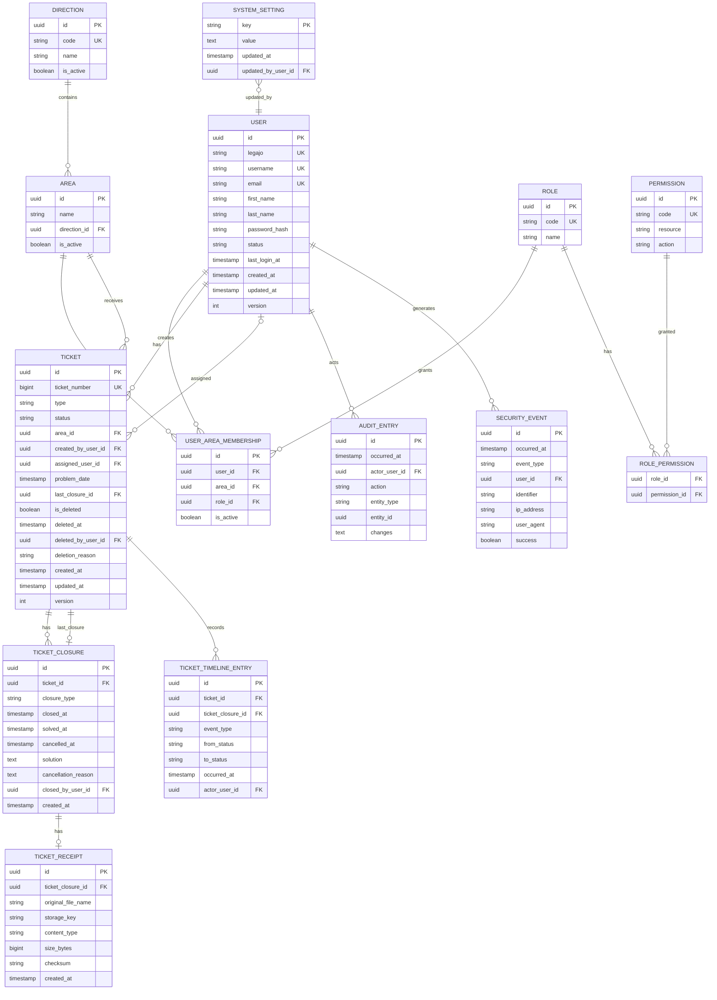

# Modelo de dominio

> **Fase 1 — Revisión 4.** Modelo en inglés. La entidad central es `Ticket`, con tipos `INCIDENT` y `TASK`.
> Las decisiones D-01 a D-39 y las aclaraciones de la Revisión 4 están incorporadas. No se agregan campos históricos redundantes cuando la trazabilidad puede reconstruirse.

## 1. Principios del modelo

1. **Identidad estable.** Usuarios, áreas, direcciones y tickets usan `id` subrogado. El legajo y el número de ticket son identificadores funcionales.
2. **Permiso ≠ alcance.** El dominio recibe el actor y evalúa permisos y alcance; no confía en la UI.
3. **Estado ≠ eliminación.** El ciclo de vida tiene cuatro estados; la eliminación es una marca separada.
4. **Creador ≠ responsable ≠ ejecutor.** Son roles distintos en el ticket y en el historial.
5. **Historial inmutable.** Las transiciones se agregan; no se editan ni se borran.
6. **Auditoría de negocio.** Se auditan cambios de negocio, no lecturas ni descargas.
7. **Multi-área.** Un usuario puede tener varias membresías; un solo rol por área.
8. **Tipo de ticket explícito.** `INCIDENT` y `TASK` son tipos, no estados ni prioridades.
9. **Cierre separado.** Los datos de cada cierre se guardan en `TicketClosure`; el ticket conserva el estado y la referencia al último cierre.
10. **Dirección derivada.** La dirección del ticket se obtiene de `Area.direction_id`; no hay dirección afectada separada.

## 2. Contextos y agregados

| Contexto | Agregados / entidades |
|---|---|
| Identidad y acceso | `User`, `UserAreaMembership`, `Role`, `Permission`, `RolePermission` |
| Organización | `Direction`, `Area` |
| Tickets | `Ticket`, `TicketClosure`, `TicketReceipt`, `TicketTimelineEntry`, `TicketReopen` (valor) |
| Auditoría | `AuditEntry` |
| Seguridad | `SecurityEvent` |
| Configuración | `SystemSetting` |

### 2.1 Agregado `Ticket`

Raíz: `Ticket`.

Entidades/valores internos:

- `TicketAssignment` (valor opcional)
- `TicketDeletion` (valor opcional)
- `TicketReopen` (valor opcional)
- `TicketClosure` (entidad hija, 0..N)
- `TicketReceipt` (entidad hija de `TicketClosure`, 0..1 por cierre)
- `TicketTimelineEntry` (entidad hija, 0..N)

Regla: las transiciones se ejecutan sobre la raíz y validan todas las invariantes del agregado. Los cierres históricos no se eliminan al reabrir.

### 2.2 Agregado `User`

Raíz: `User`.

Entidades internas:

- `UserAreaMembership` (0..N)

Regla: un usuario puede tener varias membresías; no puede tener dos activas para la misma área.

### 2.3 Agregado `Direction`

Raíz: `Direction`.

Entidades internas:

- `Area` (0..N)

Regla: un área pertenece a una dirección; no se desactiva una dirección con áreas activas.

## 3. Diagrama entidad-relación

## 4. Enumeraciones

### 4.1 `TicketType`

| Valor | Descripción |
|---|---|
| `INCIDENT` | Problema específico reportado por un área. |
| `TASK` | Problema preexistente o mejora a realizar en un área. |

### 4.2 `TicketStatus`

| Valor | Descripción |
|---|---|
| `PENDING` | Registrado, no iniciado. Estado inicial (D-34). |
| `IN_PROGRESS` | En ejecución. |
| `COMPLETED` | Resuelto con solución y comprobante. |
| `CANCELLED` | Cerrado sin ejecución. |

### 4.3 `ClosureType`

| Valor | Descripción |
|---|---|
| `COMPLETED` | Cierre por finalización. |
| `CANCELLED` | Cierre por cancelación. |

### 4.4 `UserStatus`

| Valor | Descripción |
|---|---|
| `ACTIVE` | Puede iniciar sesión y operar. |
| `INACTIVE` | No puede iniciar sesión; conserva historial. |

### 4.5 `RoleCode`

| Valor |
|---|
| `SUPERUSER` |
| `ADMINISTRATIVE` |
| `AREA_MANAGER` |
| `AGENT` |

### 4.6 `TimelineEventType`

`CREATED`, `EDITED`, `ASSIGNED`, `REASSIGNED`, `TAKEN`, `STARTED`, `COMPLETED`, `CANCELLED`, `REOPENED`, `DELETED`, `RESTORED`.

### 4.7 `AuditAction`

`CREATE`, `UPDATE`, `DELETE`, `RESTORE`, `ASSIGN`, `REASSIGN`, `TAKE`, `START`, `COMPLETE`, `CANCEL`, `REOPEN`, `DEACTIVATE`, `REACTIVATE`, `ROLE_CHANGE`, `MEMBERSHIP_CHANGE`, `SETTING_CHANGE`.

### 4.8 `SecurityEventType`

`LOGIN_SUCCESS`, `LOGIN_FAILURE`, `LOGOUT`, `ACCOUNT_LOCKED`, `RATE_LIMITED`, `SESSION_INVALIDATED`.

### 4.9 `SettingKey`

| Valor | Descripción |
|---|---|
| `TIMEZONE` | Zona horaria del sistema. |

## 5. Entidades y campos

### 5.1 `User`

| Campo | Tipo | Reglas |
|---|---|---|
| `id` | uuid | PK. |
| `legajo` | string | Único, inmutable (D-15, D-20). |
| `username` | string | Único; login por usuario o correo (D-38). |
| `email` | string | Obligatorio, único, interno (D-16, Q-013). |
| `first_name` | string | Nombre; editable por el usuario (D-33). |
| `last_name` | string | Apellido; editable por el usuario (D-33). |
| `password_hash` | string? | Hash; nunca texto plano. Puede ser nulo para el `SUPERUSER` inicial creado por seed. |
| `password_set_at` | timestamp? | Fecha en que se estableció la contraseña actual. Nulo mientras no exista una contraseña utilizable. |
| `status` | `UserStatus` | `ACTIVE`/`INACTIVE`. |
| `deactivated_at` | timestamp? | Baja lógica. |
| `deactivation_reason` | text? | Motivo de baja. |
| `reactivated_at` | timestamp? | Reactivación. |
| `last_login_at` | timestamp? | Registrado en cada login exitoso (D-38). |
| `created_at` | timestamp | Generado por servidor. |
| `updated_at` | timestamp | Generado por servidor. |
| `version` | int | Concurrencia. |

El usuario no edita su `username`, `legajo`, rol ni áreas en autogestión (D-33). La edición de `username` por el `SUPERUSER` queda como riesgo residual de Fase 2.

El seed crea el `SUPERUSER` inicial con `password_hash` nulo y `password_set_at` nulo. No se genera contraseña utilizable ni credencial predeterminada; la cuenta queda obligada a establecer contraseña mediante blanqueo/activación antes de iniciar sesión.

### 5.2 `UserAreaMembership`

| Campo | Tipo | Reglas |
|---|---|---|
| `id` | uuid | PK. |
| `user_id` | uuid | FK a `User`. |
| `area_id` | uuid | FK a `Area`. |
| `role_id` | uuid | FK a `Role`. |
| `is_active` | boolean | Una membresía activa por área y usuario. |
| `created_at` | timestamp | Generado por servidor. |
| `updated_at` | timestamp | Generado por servidor. |

### 5.3 `Role`

| Campo | Tipo | Reglas |
|---|---|---|
| `id` | uuid | PK. |
| `code` | `RoleCode` | Único; catálogo fijo (D-02, D-17). |
| `name` | string | Nombre visible. |

### 5.4 `Permission`

| Campo | Tipo | Reglas |
|---|---|---|
| `id` | uuid | PK. |
| `code` | string | Único; por ejemplo `P-TICKET_START`. |
| `resource` | string | Recurso protegido. |
| `action` | string | Acción. |

### 5.5 `RolePermission`

| Campo | Tipo | Reglas |
|---|---|---|
| `role_id` | uuid | FK a `Role`. |
| `permission_id` | uuid | FK a `Permission`. |

`P-ROLE_MANAGE` permanece reservado y no se asigna (D-17).

### 5.6 `Direction`

| Campo | Tipo | Reglas |
|---|---|---|
| `id` | uuid | PK. |
| `code` | string | Único; editable con auditoría (D-19). |
| `name` | string | Nombre. |
| `is_active` | boolean | No se desactiva con áreas activas (D-18). |
| `created_at` | timestamp | Generado por servidor. |
| `updated_at` | timestamp | Generado por servidor. |

### 5.7 `Area`

| Campo | Tipo | Reglas |
|---|---|---|
| `id` | uuid | PK. |
| `name` | string | Nombre. |
| `direction_id` | uuid | FK a `Direction`; obligatorio (D-04). |
| `is_active` | boolean | No se desactiva con usuarios/tickets activos sin reasignación (D-18). |
| `created_at` | timestamp | Generado por servidor. |
| `updated_at` | timestamp | Generado por servidor. |

### 5.8 `Ticket`

| Campo | Tipo | Reglas |
|---|---|---|
| `id` | uuid | PK. |
| `ticket_number` | bigint | Secuencial global, único, inmutable (D-26). |
| `type` | `TicketType` | Obligatorio (D-34). |
| `description` | text | Obligatoria (D-34). |
| `area_id` | uuid | FK a `Area`; obligatorio (D-34). |
| `electronic_note_id` | string? | Nota Electrónica externa opcional (D-09). |
| `affected_person_name` | string? | Opcional (D-34). |
| `affected_phone` | string? | Opcional (D-34). |
| `problem_date` | timestamp | Obligatoria; editable en abiertos (D-10/D-34). |
| `status` | `TicketStatus` | `PENDING` inicial (D-34). |
| `assigned_user_id` | uuid? | Responsable opcional (D-05). |
| `created_by_user_id` | uuid | Creador; inmutable. |
| `last_closure_id` | uuid? | Último `TicketClosure`; puede ser previo a una reapertura. |
| `last_reopen` | `TicketReopen?` | Última reapertura; el historial conserva todas. |
| `is_deleted` | boolean | Marca de eliminación lógica (D-01). |
| `deleted_at` | timestamp? | Fecha de eliminación. |
| `deleted_by_user_id` | uuid? | Actor. |
| `deletion_reason` | text? | Obligatorio al eliminar (D-34). |
| `created_at` | timestamp | Generado por servidor; inmutable. |
| `updated_at` | timestamp | Generado por servidor. |
| `version` | int | Concurrencia (D-27). |

No existe `affected_direction_id`; la dirección se obtiene de `Area.direction_id` (D-29). No existe `solution`, `solved_at`, `cancelled_at`, `cancellation_reason` ni `receipt_id` en `Ticket`; esos datos viven en `TicketClosure` (D-30).

### 5.9 `TicketClosure`

| Campo | Tipo | Reglas |
|---|---|---|
| `id` | uuid | PK. |
| `ticket_id` | uuid | FK a `Ticket`. |
| `closure_type` | `ClosureType` | `COMPLETED` o `CANCELLED`. |
| `closed_at` | timestamp | Fecha del cierre. |
| `solved_at` | timestamp? | Obligatorio si `COMPLETED`; base de estadísticas. |
| `cancelled_at` | timestamp? | Obligatorio si `CANCELLED`; base de estadísticas. |
| `solution` | text? | Obligatorio si `COMPLETED` (D-34). |
| `cancellation_reason` | text? | Obligatorio si `CANCELLED` (D-34). |
| `closed_by_user_id` | uuid | Actor del cierre. |
| `created_at` | timestamp | Generado por servidor. |

Un ticket puede tener varios cierres históricos. El comprobante se asocia al cierre mediante `TicketReceipt.ticket_closure_id`.

No se agrega `assigned_user_id` a `TicketClosure`. El responsable asignado en cada cierre se reconstruye a partir de `TicketTimelineEntry`, cuyos eventos de asignación deben conservar el responsable anterior y posterior. `TicketClosure` conserva `closed_by_user_id` como actor del cierre, no como responsable histórico.

### 5.10 `TicketReceipt`

| Campo | Tipo | Reglas |
|---|---|---|
| `id` | uuid | PK. |
| `ticket_closure_id` | uuid | FK a `TicketClosure`; un comprobante por cierre. |
| `original_file_name` | string | Nombre original. |
| `storage_key` | string | Clave local; sin URL pública. |
| `content_type` | string | `application/pdf`. |
| `size_bytes` | bigint | Tamaño validado. |
| `checksum` | string | Integridad. |
| `created_at` | timestamp | Generado por servidor. |

### 5.11 `TicketReopen`

| Campo | Tipo | Reglas |
|---|---|---|
| `reopened_at` | timestamp | Fecha. |
| `reopened_by_user_id` | uuid | Actor. |
| `reason` | text | Obligatorio (D-30). |
| `target_status` | `TicketStatus` | `PENDING` o `IN_PROGRESS`. |
| `previous_closure_id` | uuid | Cierre desde el que se reabrió. |

### 5.12 `TicketTimelineEntry`

El historial funcional es la fuente de trazabilidad para responsables históricos, eliminaciones, restauraciones y cambios de asignación. `metadata` debe conservar, cuando corresponda, `assigned_user_id_before`, `assigned_user_id_after`, `deletion_reason` y los datos propios del evento. Los eventos `ASSIGNED`, `REASSIGNED` y `TAKEN` deben permitir reconstruir el responsable asignado antes y después de cada cambio. Los eventos `DELETED` y `RESTORED` deben permitir reconstruir cada ciclo de eliminación/restauración, incluso si se repite varias veces.

| Campo | Tipo | Reglas |
|---|---|---|
| `id` | uuid | PK. |
| `ticket_id` | uuid | FK a `Ticket`. |
| `ticket_closure_id` | uuid? | Cierre relacionado, si aplica. |
| `event_type` | `TimelineEventType` | Evento. |
| `from_status` | `TicketStatus?` | Estado anterior. |
| `to_status` | `TicketStatus?` | Estado nuevo. |
| `occurred_at` | timestamp | Fecha. |
| `actor_user_id` | uuid | Actor. |
| `metadata` | json? | Datos adicionales. |

### 5.13 `AuditEntry`

| Campo | Tipo | Reglas |
|---|---|---|
| `id` | uuid | PK. |
| `occurred_at` | timestamp | Fecha. |
| `actor_user_id` | uuid? | Actor; puede ser nulo en procesos del sistema. |
| `action` | `AuditAction` | Acción de negocio. |
| `entity_type` | string | Entidad afectada. |
| `entity_id` | uuid? | Identificador. |
| `changes` | json? | Valores anteriores/nuevos. |

Sólo cambios de negocio; no lecturas, descargas ni eventos de seguridad (D-22/D-39).

### 5.14 `SecurityEvent`

| Campo | Tipo | Reglas |
|---|---|---|
| `id` | uuid | PK. |
| `occurred_at` | timestamp | Fecha. |
| `event_type` | `SecurityEventType` | Tipo. |
| `user_id` | uuid? | Usuario, si se conoce. |
| `identifier` | string? | Usuario/correo intentado. |
| `ip_address` | string? | Origen. |
| `user_agent` | string? | Cliente. |
| `success` | boolean | Resultado. |

No se expone por `/audit-events` (D-39).

### 5.15 `SystemSetting`

| Campo | Tipo | Reglas |
|---|---|---|
| `key` | `SettingKey` | PK. |
| `value` | text | Valor. |
| `updated_at` | timestamp | Fecha. |
| `updated_by_user_id` | uuid | Actor. |

En la primera versión sólo se administra `TIMEZONE` (D-37).

## 6. Relaciones y cardinalidades

| Relación | Cardinalidad | Regla |
|---|---|---|
| `User` → `UserAreaMembership` | 1:N | Una membresía activa por área. |
| `Area` → `UserAreaMembership` | 1:N | Membresías del área. |
| `Role` → `UserAreaMembership` | 1:N | Un rol por membresía. |
| `Role` ↔ `Permission` | N:M | Permisos declarativos. |
| `Direction` → `Area` | 1:N | Toda área tiene dirección. |
| `Area` → `Ticket` | 1:N | Todo ticket tiene área. |
| `User` → `Ticket` (creador) | 1:N | Creador inmutable. |
| `User` → `Ticket` (responsable) | 1:0..N | Responsable opcional. |
| `Ticket` → `TicketClosure` | 1:N | Cierres históricos. |
| `Ticket` → `TicketClosure` (último) | 1:0..1 | `last_closure_id`. |
| `TicketClosure` → `TicketReceipt` | 1:0..1 | Un comprobante por cierre. |
| `Ticket` → `TicketTimelineEntry` | 1:N | Historial. |
| `User` → `AuditEntry` | 1:N | Actor de auditoría. |
| `User` → `SecurityEvent` | 1:N | Eventos de seguridad. |
| `SystemSetting` → `User` | N:1 | Último editor. |

No existe relación directa `Direction` → `Ticket` (D-29).

## 7. Invariantes

1. Todo ticket nace en `PENDING` (D-34).
2. `type`, `description`, `area_id` y `problem_date` son obligatorios (D-34).
3. `INCIDENT` no admite `problem_date` futura; `TASK` sí (D-10/D-32).
4. `COMPLETED` tiene un `TicketClosure` `COMPLETED` con `solution` y comprobante (D-11/D-30/D-34).
5. `CANCELLED` tiene un `TicketClosure` `CANCELLED` con `cancellation_reason` (D-30/D-34).
6. Un ticket puede tener varios cierres; `last_closure_id` apunta al más reciente.
7. La reapertura exige motivo, destino `PENDING`/`IN_PROGRESS` y el mismo responsable del cierre (D-30).
8. Un ticket eliminado debe restaurarse antes de reabrir (D-30).
9. La eliminación conserva `status`, cierres e historial (D-01).
10. La restauración conserva `status`, cierres e historial (D-01).
11. Sólo se editan tickets `PENDING`/`IN_PROGRESS` (D-34).
12. El responsable debe estar `ACTIVE`, pertenecer al área y tener rol `AGENT` o `AREA_MANAGER` (D-05).
13. Un usuario puede tener varias membresías, pero una sola activa por área (D-21).
14. Un `SUPERUSER` activo otorga alcance global (D-03).
15. No se puede dejar el sistema sin `SUPERUSER` activo (D-36).
16. El comprobante pertenece al cierre y no se reemplaza (D-11/D-25/D-30).
17. La dirección del ticket se deriva de `Area.direction_id` (D-29).
18. Los eventos de seguridad no se mezclan con la auditoría de negocio (D-39).
19. Los usuarios inactivos no inician sesión y se excluyen de listados operativos (D-33).
20. La zona horaria es `America/Argentina/Buenos_Aires` por defecto y configurable por el `SUPERUSER` (D-14/D-37).
21. El responsable histórico de un cierre se reconstruye desde `TicketTimelineEntry`; no se duplica en `TicketClosure`.
22. La reapertura o restauración no puede mantener una asignación inválida; el actor debe reasignar o desasignar antes de completar la operación.
23. La eliminación y la restauración se registran como eventos históricos; los campos actuales de `Ticket` sólo reflejan la última operación.
24. El seed inicial no crea una contraseña utilizable para el `SUPERUSER`; `password_set_at` permanece nulo hasta el blanqueo/activación.
25. La asignación inicial del ticket se registra en `TicketTimelineEntry` (evento `CREATED`) mediante `metadata`.
26. Los cambios de asignación registran `assigned_user_id_before` y `assigned_user_id_after` en `TicketTimelineEntry`.
27. La secuencia temporal de `TicketTimelineEntry` permite relacionar cada cierre con el responsable vigente.
28. `TicketTimelineEntry` es inmutable; no se edita ni se elimina.

## 8. Modelo de estados

- `PENDING` → `IN_PROGRESS` (iniciar).
- `PENDING`/`IN_PROGRESS` → `CANCELLED` (cancelar).
- `IN_PROGRESS` → `COMPLETED` (completar).
- `COMPLETED`/`CANCELLED` → `PENDING`/`IN_PROGRESS` (reabrir).
- Cualquier estado → eliminado (marca) → activo (restauración, conserva estado).

Detalle en [`task-lifecycle.md`](./task-lifecycle.md).

## 9. Auditoría y logs

- `AuditEntry` registra cambios de negocio: altas, ediciones, asignaciones, transiciones, cierres, reaperturas, eliminaciones, restauraciones, cambios de usuarios/membresías y configuración.
- No registra lecturas, descargas ni eventos de seguridad.
- `SecurityEvent` registra login, logout, intentos fallidos, bloqueos, rate limiting e invalidaciones de sesión.
- `SecurityEvent` no se expone por `/audit-events` (D-39).

## 10. Reglas de validación

| Regla | Validación |
|---|---|
| Tipo | `INCIDENT` o `TASK`. |
| Descripción | No vacía. |
| Área | Activa y existente. |
| `problem_date` | Obligatoria; futura sólo `TASK`. |
| Estado inicial | `PENDING`. |
| Cierre completado | `solution` no vacía y PDF válido. |
| Cierre cancelado | `cancellation_reason` no vacío. |
| Eliminación | `deletion_reason` no vacío. |
| Reapertura | Motivo no vacío; destino `PENDING`/`IN_PROGRESS`; mismo responsable. |
| Edición | Sólo `PENDING`/`IN_PROGRESS`; no altera campos inmutables. |
| Responsable | `ACTIVE`, membresía activa, rol `AGENT`/`AREA_MANAGER`. |
| Último `SUPERUSER` | No baja, auto-baja ni cambio de rol. |

## 11. Decisiones incorporadas

No quedan decisiones pendientes que afecten el modelo. Las decisiones D-29 a D-39 están incorporadas; los riesgos residuales están en [`open-decisions.md`](./open-decisions.md).
