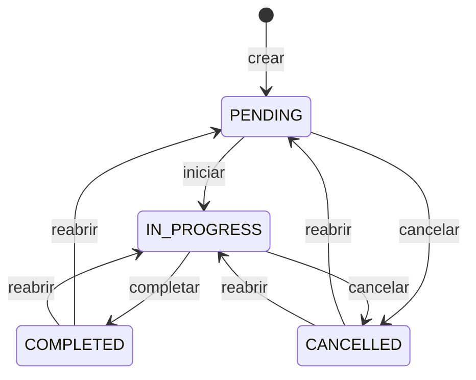
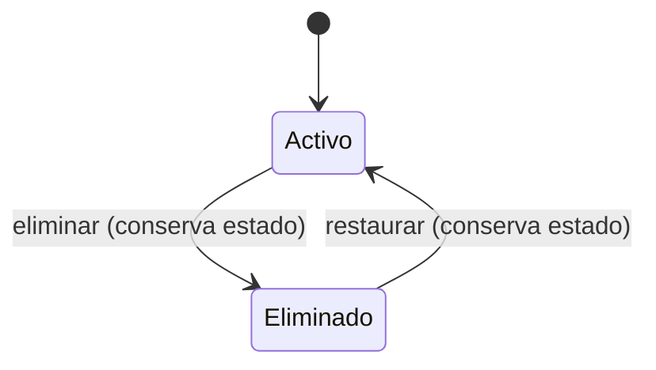

# Ciclo de vida de tickets

> **Fase 1 — Revisión 4.** Basado en `docs/specification-definitions.md` (D-01 a D-39) y las aclaraciones de la Revisión 4.
> La entidad central es `Ticket`. “Tarea” se reemplaza por “ticket” cuando se habla del requerimiento.

## 1. Tipos de ticket

| Tipo | Definición | `problem_date` futura | Reglas adicionales |
|---|---|---|---|
| `INCIDENT` | Problema específico reportado por un área. | No permitida. | Ninguna adicional aprobada. |
| `TASK` | Problema preexistente o mejora a realizar en un área. | Permitida. | Ninguna adicional aprobada. |

`INCIDENT` y `TASK` se diferencian por la fecha futura y por su descripción funcional; pueden contabilizarse por separado (D-32). No se asumen prioridad, SLA, flujo ni asignación distintos.

## 2. Estados

| Estado | Descripción | ¿Operativo? |
|---|---|---|
| `PENDING` | Ticket registrado, aún no iniciado. Estado inicial (D-34). | Sí |
| `IN_PROGRESS` | Ticket en ejecución. | Sí |
| `COMPLETED` | Ticket completado; tiene un `TicketClosure` de tipo `COMPLETED`. | No |
| `CANCELLED` | Ticket cancelado; tiene un `TicketClosure` de tipo `CANCELLED`. | No |

La eliminación **no** es un estado. Es una marca independiente (`is_deleted`, `deleted_at`, `deleted_by_user_id`, `deletion_reason`) que conserva el estado (D-01).

## 3. Campos de negocio del ticket

| Campo | Tipo | Regla |
|---|---|---|
| `id` | uuid | PK. |
| `ticket_number` | integer | Secuencial global, inmutable (D-26). |
| `type` | `TicketType` | `INCIDENT` o `TASK`; obligatorio (D-34). |
| `description` | text | Obligatoria (D-34). |
| `area_id` | uuid | FK a `Area`; obligatorio (D-34). |
| `electronic_note_id` | string? | Nota Electrónica externa opcional (D-09). |
| `affected_person_name` | string? | Opcional (D-34). |
| `affected_phone` | string? | Opcional (D-34). |
| `problem_date` | timestamp | Obligatoria; fecha/hora; editable en abiertos (D-10/D-34). |
| `status` | `TicketStatus` | `PENDING` inicial (D-34). |
| `assigned_user_id` | uuid? | Responsable opcional (D-05). |
| `created_by_user_id` | uuid | Creador; inmutable. |
| `created_at` | timestamp | Generado por servidor; inmutable. |
| `updated_at` | timestamp | Generado por servidor. |
| `version` | int | Concurrencia optimista (D-27). |
| `is_deleted` | boolean | Marca de eliminación lógica (D-01). |
| `deleted_at` | timestamp? | Fecha de eliminación. |
| `deleted_by_user_id` | uuid? | Actor de la eliminación. |
| `deletion_reason` | text? | Obligatorio al eliminar (D-34). |
| `last_closure_id` | uuid? | Último `TicketClosure`; permite consultar el cierre más reciente. |
| `last_reopen` | `TicketReopen?` | Última reapertura; el historial conserva todas. |

La dirección no se almacena en el ticket: se deriva de `Area.direction_id` (D-29).

## 4. `TicketClosure`

Los datos de cierre se persisten en una entidad separada, no en el ticket (D-30).

| Campo | Tipo | Regla |
|---|---|---|
| `id` | uuid | PK. |
| `ticket_id` | uuid | FK a `Ticket`. |
| `closure_type` | `ClosureType` | `COMPLETED` o `CANCELLED`. |
| `closed_at` | timestamp | Fecha del cierre. |
| `solved_at` | timestamp? | Obligatorio si `COMPLETED`; base de estadísticas. |
| `cancelled_at` | timestamp? | Obligatorio si `CANCELLED`; base de estadísticas. |
| `closed_by_user_id` | uuid | Actor del cierre. |
| `solution` | text? | Obligatoria si `closure_type = COMPLETED` (D-34). |
| `cancellation_reason` | text? | Obligatorio si `closure_type = CANCELLED` (D-34). |
| `created_at` | timestamp | Generado por servidor. |

El comprobante se asocia al cierre mediante `TicketReceipt.ticket_closure_id`; es obligatorio para un cierre `COMPLETED` (D-11).

El responsable histórico de cada cierre no se duplica en `TicketClosure`; se reconstruye a partir de `TicketTimelineEntry`, cuyos eventos de asignación conservan el responsable anterior y posterior.

Reglas:

1. Un ticket puede tener varios `TicketClosure` históricos.
2. Cada cierre tiene como máximo un comprobante.
3. Al reabrir, el cierre anterior se conserva y el ticket vuelve a `PENDING` o `IN_PROGRESS`.
4. Un nuevo cierre agrega un nuevo `TicketClosure`; no sobrescribe el anterior.
5. El comprobante pertenece al cierre, no al ticket completo.
6. `last_closure_id` apunta al cierre más reciente; en un ticket abierto puede apuntar al cierre previo a la reapertura.

## 5. `TicketReopen`

| Campo | Tipo | Regla |
|---|---|---|
| `reopened_at` | timestamp | Fecha de la última reapertura. |
| `reopened_by_user_id` | uuid | Actor. |
| `reason` | text | Obligatorio (D-30). |
| `target_status` | `TicketStatus` | `PENDING` o `IN_PROGRESS` (D-30). |
| `previous_closure_id` | uuid | Cierre desde el que se reabrió. |

El historial conserva todas las reaperturas; `Ticket.last_reopen` sólo expone la última.

## 6. Diagrama de estados

La eliminación y la restauración son ortogonales al estado:

## 7. Transiciones

### T-01 — Crear ticket

| Atributo | Regla |
|---|---|
| Actores | `SUPERUSER`, `ADMINISTRATIVE`, `AREA_MANAGER` |
| Hacia | `PENDING` |
| Precondiciones | `type`, `description`, `area_id` y `problem_date` válidos; área dentro del alcance; `problem_date` futura sólo `TASK`. |
| Efectos | Genera `ticket_number`, `created_at`, `created_by_user_id`, evento `CREATED` y auditoría. |
| Datos opcionales | `electronic_note_id`, `affected_person_name`, `affected_phone`. |

### T-02 — Iniciar ticket

| Atributo | Regla |
|---|---|
| Actores | `SUPERUSER`; `ADMINISTRATIVE` en su área; `AREA_MANAGER` en su área; `AGENT` asignado. |
| Desde / hacia | `PENDING` → `IN_PROGRESS` |
| Precondiciones | Ticket no eliminado; alcance válido; versión vigente. |
| Efectos | Cambia estado; evento `STARTED`; auditoría. |

### T-03 — Completar ticket

| Atributo | Regla |
|---|---|
| Actores | `SUPERUSER`; `AREA_MANAGER` en su área; `AGENT` asignado. `ADMINISTRATIVE` no. |
| Desde / hacia | `IN_PROGRESS` → `COMPLETED` |
| Precondiciones | Ticket no eliminado; `solution` obligatoria; comprobante PDF válido; alcance válido. |
| Efectos | Crea `TicketClosure` de tipo `COMPLETED` con `solved_at`, `solution` y `closed_by_user_id`; asocia el comprobante al cierre; actualiza `last_closure_id`; evento `COMPLETED`; auditoría. |

### T-04 — Cancelar ticket desde `PENDING`

| Atributo | Regla |
|---|---|
| Actores | `SUPERUSER`; `AREA_MANAGER` en su área; `AGENT` asignado. `ADMINISTRATIVE` no. |
| Desde / hacia | `PENDING` → `CANCELLED` |
| Precondiciones | Ticket no eliminado; motivo obligatorio; alcance válido. |
| Efectos | Crea `TicketClosure` de tipo `CANCELLED` con `cancelled_at`, `cancellation_reason` y `closed_by_user_id`; actualiza `last_closure_id`; evento `CANCELLED`; auditoría. |

### T-05 — Cancelar ticket desde `IN_PROGRESS`

| Atributo | Regla |
|---|---|
| Actores | `SUPERUSER`; `AREA_MANAGER` en su área; `AGENT` asignado. `ADMINISTRATIVE` no. |
| Desde / hacia | `IN_PROGRESS` → `CANCELLED` |
| Precondiciones | Ticket no eliminado; motivo obligatorio; alcance válido. |
| Efectos | Igual que T-04. |

### T-06 — Reabrir ticket

| Atributo | Regla |
|---|---|
| Actores | `SUPERUSER`; `ADMINISTRATIVE` en su área; `AREA_MANAGER` en su área. `AGENT` no. |
| Desde | `COMPLETED` o `CANCELLED` |
| Hacia | `PENDING` o `IN_PROGRESS`, elegido por ticket (D-30). |
| Precondiciones | Ticket no eliminado; si está eliminado, restaurarlo primero; motivo obligatorio; el responsable debe ser el mismo que tenía al cierre; alcance válido. Si el responsable actual está inactivo, ya no pertenece al área o dejó de ser elegible, la operación exige reasignar a un usuario activo y elegible del área o dejar el ticket sin responsable antes de reabrir. |
| Efectos | Cambia estado; registra `TicketReopen`; evento `REOPENED`; conserva el `TicketClosure` anterior y su comprobante; auditoría. La asignación inválida no se conserva. |
| Datos de cierre | No se borran ni se sobrescriben; permanecen en `TicketClosure`. |
| Asignación | Se conserva el `assigned_user_id` que tenía el ticket al cierre siempre que siga siendo elegible. Si no lo es, se permite reasignar o desasignar como excepción explícita a la inmutabilidad del ticket cerrado. Esa corrección de asignación no habilita la edición general del ticket cerrado. |

### T-07 — Eliminar ticket

| Atributo | Regla |
|---|---|
| Actores | `SUPERUSER`; `AREA_MANAGER` en su área. `ADMINISTRATIVE` y `AGENT` no. |
| Desde | Cualquier estado. |
| Precondiciones | Ticket no eliminado; motivo obligatorio; alcance válido. |
| Efectos | Marca `is_deleted`, `deleted_at`, `deleted_by_user_id` y `deletion_reason`; conserva `status`; evento `DELETED`; auditoría. |
| Cierres | Los `TicketClosure` y comprobantes se conservan. |

### T-08 — Restaurar ticket

| Atributo | Regla |
|---|---|
| Actores | `SUPERUSER`; `AREA_MANAGER` en su área. `ADMINISTRATIVE` y `AGENT` no. |
| Desde / hacia | Eliminado → activo, conservando el estado previo. |
| Precondiciones | Ticket eliminado; alcance válido. Si el responsable actual está inactivo, ya no pertenece al área o dejó de ser elegible, la operación exige reasignar a un usuario activo y elegible del área o dejar el ticket sin responsable antes de restaurar, incluso cuando el ticket vuelva a un estado cerrado. |
| Efectos | Limpia `is_deleted`, `deleted_at`, `deleted_by_user_id` y `deletion_reason`; conserva `status`, cierres e historial; evento `RESTORED`; auditoría. La asignación inválida no se conserva. |
| Asignación | La restauración conserva el estado previo. Si el responsable es inválido, exige reasignación o desasignación. La corrección de asignación no habilita la edición general del ticket. |
| Motivo | D-34 no exige motivo de restauración; se registra actor y fecha. |

### T-09 — Asignar responsable

| Atributo | Regla |
|---|---|
| Actores | `SUPERUSER`; `ADMINISTRATIVE` en su área; `AREA_MANAGER` en su área. |
| Precondiciones | Ticket no eliminado; `PENDING` o `IN_PROGRESS`; responsable `ACTIVE`, con membresía activa en el área y rol `AGENT` o `AREA_MANAGER`; alcance válido. |
| Efectos | Actualiza `assigned_user_id`; evento `ASSIGNED`; auditoría. |

### T-10 — Reasignar responsable

| Atributo | Regla |
|---|---|
| Actores | `SUPERUSER`; `AREA_MANAGER` en su área. `ADMINISTRATIVE` no. |
| Precondiciones | Ticket no eliminado; `PENDING` o `IN_PROGRESS`; responsable elegible; alcance válido. |
| Efectos | Cambia `assigned_user_id`; evento `REASSIGNED`; auditoría. |

### T-11 — Tomar ticket

| Atributo | Regla |
|---|---|
| Actores | `AGENT` con membresía activa en el área del ticket; `SUPERUSER` sólo si además es elegible como `AGENT` o `AREA_MANAGER` en el área. |
| Precondiciones | Ticket sin asignar; `PENDING` o `IN_PROGRESS`; no eliminado; alcance válido. |
| Efectos | Asigna al actor; evento `TAKEN`; auditoría. |

### T-12 — Editar ticket

| Atributo | Regla |
|---|---|
| Actores | `SUPERUSER`; `ADMINISTRATIVE` si es creador; `AREA_MANAGER` en su área. `AGENT` no. |
| Precondiciones | Ticket `PENDING` o `IN_PROGRESS`; no eliminado; alcance válido. |
| Campos editables | Campos de negocio del ticket abierto: `type`, `description`, `electronic_note_id`, `affected_person_name`, `affected_phone`, `area_id` y `problem_date`. |
| Restricciones | No altera estado, creador, `created_at`, `ticket_number`, cierre, comprobante, cancelación ni eliminación (D-34). |
| Efectos | Actualiza `updated_at` y `version`; evento `EDITED`; auditoría. |

## 8. Invariantes

1. Todo ticket nace en `PENDING` (D-34).
2. `INCIDENT` no admite `problem_date` futura; `TASK` sí (D-10/D-32).
3. `COMPLETED` tiene un `TicketClosure` de tipo `COMPLETED` con `solution` y comprobante (D-11/D-30/D-34).
4. `CANCELLED` tiene un `TicketClosure` de tipo `CANCELLED` con motivo (D-30/D-34).
5. Un ticket puede tener varios cierres históricos; el último se referencia en `last_closure_id`.
6. La reapertura exige motivo, destino `PENDING`/`IN_PROGRESS` y el mismo responsable del cierre (D-30).
7. Un ticket eliminado debe restaurarse antes de reabrir (D-30).
8. La eliminación conserva el estado y los cierres (D-01).
9. La restauración conserva el estado y los cierres (D-01).
10. La edición sólo se permite en `PENDING`/`IN_PROGRESS` (D-34).
11. El historial y la auditoría son inmutables.
12. La dirección se deriva de `Area.direction_id` (D-29).
13. El responsable histórico de un cierre se reconstruye desde `TicketTimelineEntry`; no se duplica en `TicketClosure`.
14. La reapertura y la restauración no conservan una asignación inválida; exigen reasignación o desasignación.
15. Los eventos de eliminación y restauración permiten reconstruir cada ciclo, aunque se repitan.

## 9. Historial

Eventos mínimos:

- `CREATED`
- `STARTED`
- `COMPLETED`
- `CANCELLED`
- `REOPENED`
- `DELETED`
- `RESTORED`
- `ASSIGNED`
- `REASSIGNED`
- `TAKEN`
- `EDITED`

Cada evento registra actor, timestamp, estado anterior/nuevo cuando aplica y referencia al `TicketClosure` cuando corresponde. Los eventos de asignación conservan el responsable anterior y posterior; los eventos de eliminación y restauración conservan motivo, actor y secuencia. El historial no se modifica ni se elimina.

## 10. Escenarios de verificación

1. Un `INCIDENT` con `problem_date` futura se rechaza; un `TASK` se acepta.
2. Un ticket `COMPLETED` no se edita; se reabre o se elimina.
3. Un `ADMINISTRATIVE` inicia y reabre en su área, pero no completa ni restaura.
4. Un `AREA_MANAGER` completa, restaura y reabre en su área.
5. Un `AGENT` inicia, completa y cancela sólo sus tickets.
6. Reabrir un ticket completado conserva su cierre y comprobante; el nuevo cierre crea otro `TicketClosure`.
7. Reabrir un ticket eliminado se rechaza hasta restaurarlo.
8. Eliminar un ticket conserva su estado; restaurar lo devuelve al mismo estado.
9. Un ticket cancelado exige motivo; uno completado exige solución y PDF.
10. La dirección mostrada coincide con la dirección del área.

## 11. Decisiones incorporadas

No quedan decisiones pendientes que afecten el ciclo de vida. Las decisiones D-29 a D-39 están incorporadas; los riesgos residuales están en [`open-decisions.md`](./open-decisions.md).
